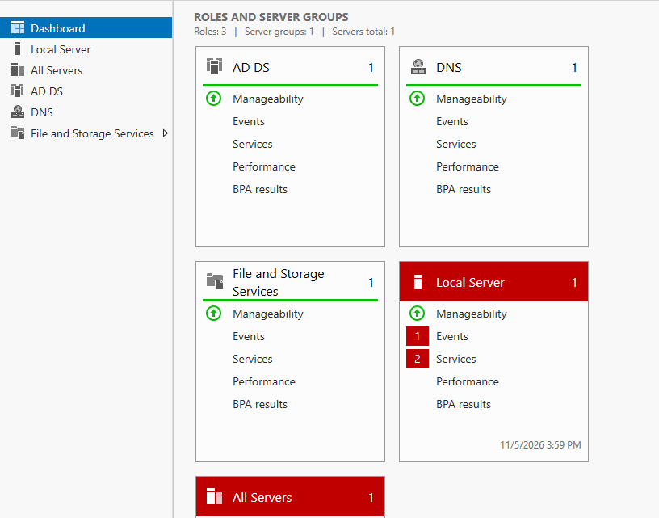
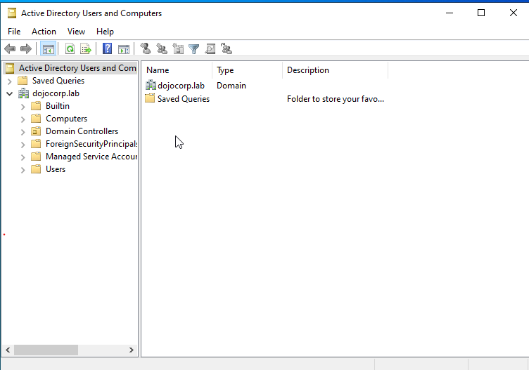
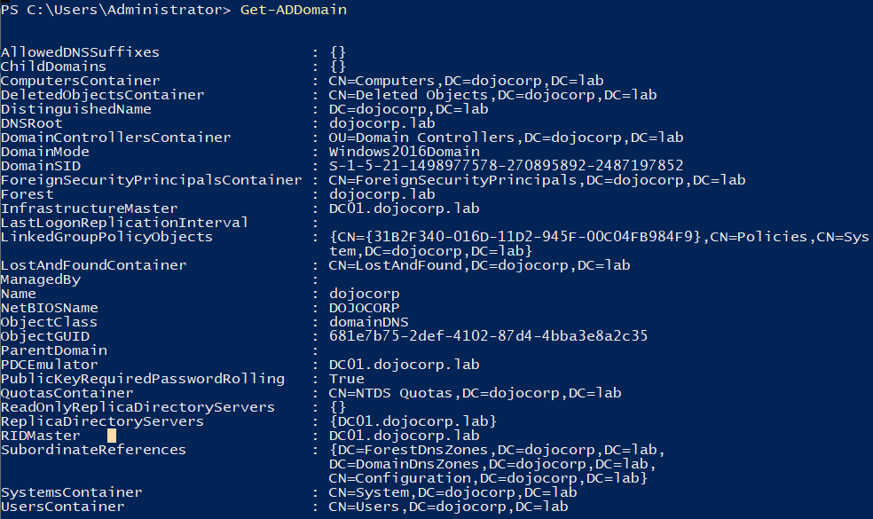
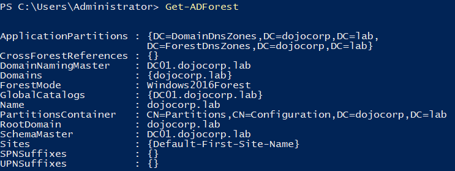
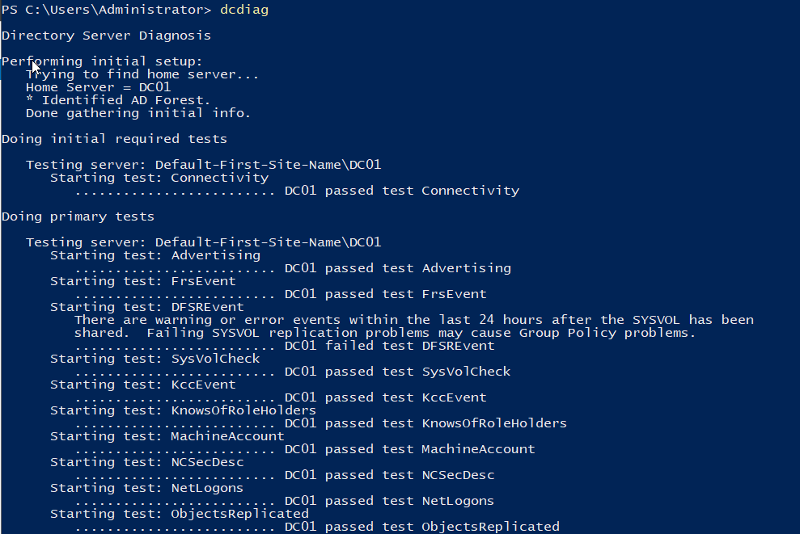
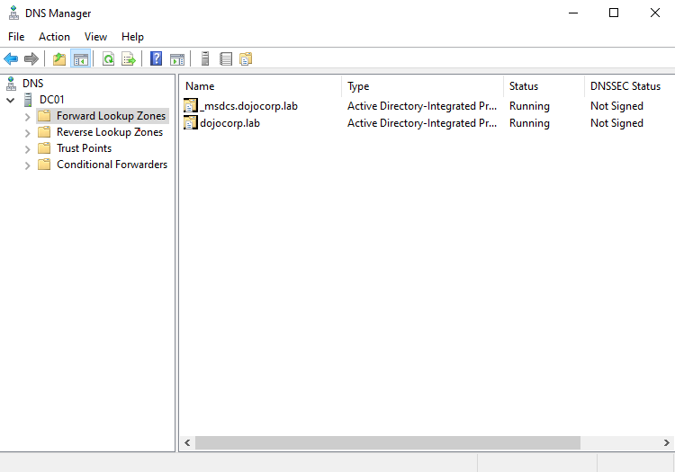

# 02 - Domain Setup

## Objective
Install Active Directory Domain Services (AD DS) on DC01 and promote it to the first domain controller of a new forest, `dojocorp.lab`.

## Prerequisites
- DC01 renamed and set to static IP `192.168.10.10` (see [01-planning.md](01-planning.md))
- DNS pointed at itself (`192.168.10.10`)
- Snapshot taken before changes: "DC01 clean install, before AD"

## Steps

### 1. Install the AD DS role
1. In Server Manager, selected Manage, then Add Roles and Features.
2. Chose role-based installation and selected DC01 as the target server.
3. Ticked Active Directory Domain Services and accepted the required features.
4. Installed the role without restarting.

### 2. Promote DC01 to a domain controller
1. Selected "Promote this server to a domain controller" from the notification flag.
2. Chose "Add a new forest" with root domain name `dojocorp.lab`.
3. Kept the default functional levels, with DNS Server and Global Catalog ticked.
4. Set a Directory Services Restore Mode (DSRM) password and stored it outside this repo.
5. Saw a DNS delegation warning. This is expected in an isolated lab with no parent DNS zone, so I continued.
6. Confirmed the NetBIOS name `DOJOCORP` and left the default folder paths.
7. Ran the prerequisites check, then installed. DC01 restarted automatically.

I did not capture screenshots during steps 1 and 2, so the evidence below shows the finished result.

## Verification

| Check | What it shows | Screenshot |
|-------|---------------|------------|
| Server Manager dashboard | AD DS and DNS roles installed |  |
| Active Directory Users and Computers | `dojocorp.lab` domain with default containers |  |
| System properties | Full computer name `DC01.dojocorp.lab` |  |
| `Get-ADDomain` | Domain name and NetBIOS name |  |
| `Get-ADForest` | Forest root domain |  |
| `dcdiag` | Domain controller health tests |  |
| DNS Manager | Forward lookup zone for `dojocorp.lab` |  |

## Result
DC01 is the domain controller and DNS server for `dojocorp.lab`. I logged in as `DOJOCORP\Administrator` after the restart. `dcdiag` results: [write what you saw, e.g. "all tests passed" or name any that failed].

## Issues and fixes
- None

## What I learned
- A domain controller needs a static IP and DNS pointing at itself, because AD depends on DNS to work.

## Snapshot
"DC01 domain controller promoted" taken after verification.

## Next
Build the OU structure, users and groups: [03-ou-groups.md](03-ou-groups.md).
