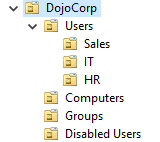
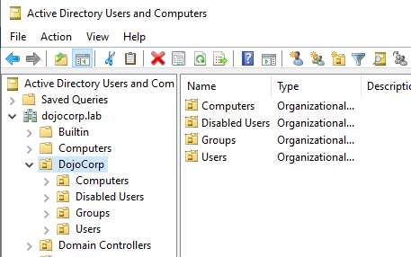
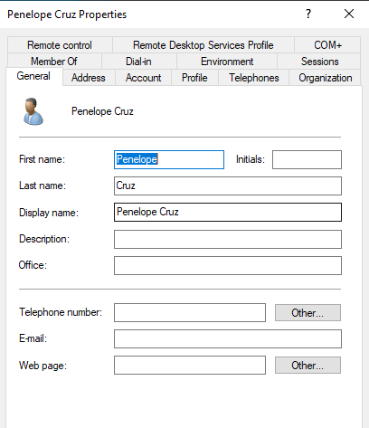
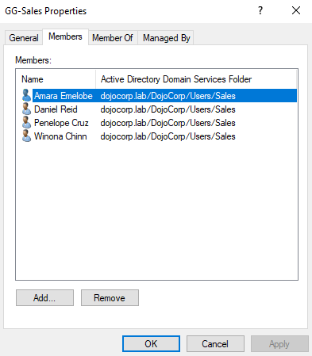
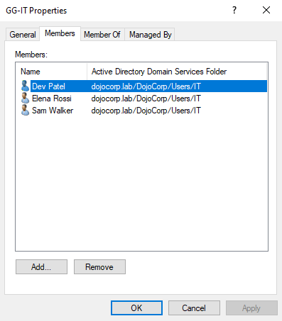
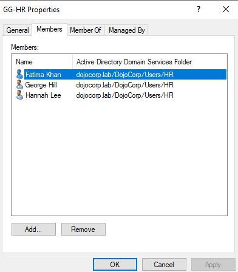
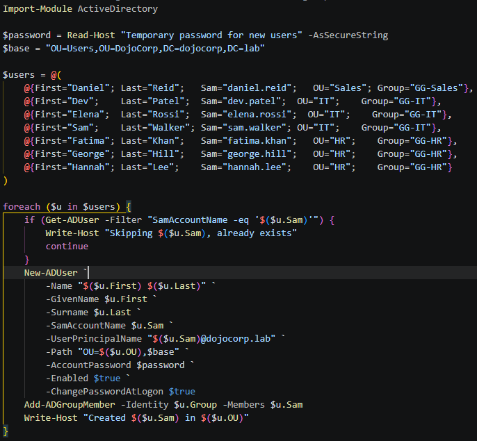

# 03 - OUs, Users and Groups

## Objective
Build an organisational unit (OU) structure for DojoCorp, create test users and add them to security groups.

## OU structure
I created a top-level `DojoCorp` OU with sub-OUs for users, computers, groups and disabled accounts. The Users OU is split by department.

```
dojocorp.lab
└── DojoCorp
    ├── Users
    │   ├── HR
    │   │   ├── Fatima Khan
    │   │   ├── George Hill
    │   │   └── Hannah Lee
    │   ├── IT
    │   │   ├── Dev Patel
    │   │   ├── Elena Rossi
    │   │   └── Sam Walker
    │   └── Sales
    │       ├── Amara Emelobe
    │       ├── Daniel Reid
    │       ├── Penelope Cruz
    │       └── Winona Chinn
    ├── Computers
    ├── Groups
    └── Disabled Users
```
OUs are protected from accidental deletion. The `Disabled Users` OU is for offboarding (see [06-offboarding.md](06-offboarding.md)).




## Users

| Department | User | Logon name | Created by |
|------------|------|------------|------------|
| Sales | Amara Emelobe | amara.emelobe | Manual |
| Sales | Penelope Cruz | penelope.cruz | Manual |
| Sales | Winona Chinn | winona.chinn | Manual |
| Sales | Daniel Reid | daniel.reid | Script |
| IT | Dev Patel | dev.patel | Script |
| IT | Elena Rossi | elena.rossi | Script |
| IT | Sam Walker | sam.walker | Script |
| HR | Fatima Khan | fatima.khan | Script |
| HR | George Hill | george.hill | Script |
| HR | Hannah Lee | hannah.lee | Script |

Logon names follow a `firstname.lastname` format. Every account has a temporary password and is set to change it at first logon.

- The first three users were created by manually in Active Directory Users and Computers to learn the process.
- The remaining seven were created with a PowerShell script (see below).
- Every account has a temporary password and is set to change it at first logon.



## Groups
I created three global security groups in the `Groups` OU and added users to match their department.

| Group | Scope and type | Members |
|-------|----------------|---------|
| GG-Sales | Global, Security | Sales users |
| GG-IT | Global, Security | IT users |
| GG-HR | Global, Security | HR users |

Managing access through groups means permissions are given to a department once, not to each person.





## Automation
I wrote a PowerShell script to create the remaining users in bulk. It:
- Asks for the temporary password when run, so no password is stored in the script or repo
- Skips any user that already exists, so it is safe to run twice
- Creates each user in the correct OU and adds them to their department group
- Forces a password change at first logon

Script: [scripts/bulk-create-users.ps1](../scripts/bulk-create-users.ps1)



## Issues and fixes
None

## What I learned
- OUs organise objects and are where Group Policy is applied.
- Groups make access easier to manage than giving permissions to individual users.
- Scripting repetitive tasks is faster and more consistent than clicking through the same screens.

## Snapshot
"DC01 OUs users groups built"

## Next
Create the Windows 11 client and join it to the domain, then build Group Policy in [04-group-policy.md](04-group-policy.md).
